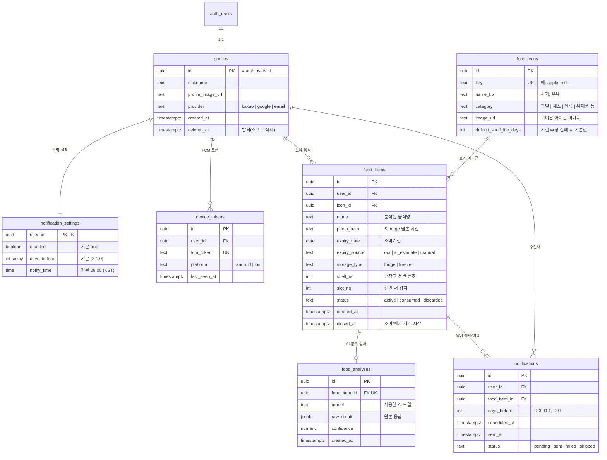

# "먹어도 돼?" 프로젝트 CLAUDE.md

이 폴더(`period_push`)는 "먹어도 돼?" 앱 프로젝트의 루트다. 관리자 사이트는 앱을 만든 뒤에 별도로 정한다.

## 서비스 개요

회원이 찍은 음식 사진을 분석해 소비기한을 관리해 주는 서비스.

1. 회원이 찍은 사진의 음식과 소비기한을 자동으로 분석하고 리스트업한다.
2. 리스트업된 음식은 달력으로 표시된다.
3. 소비기한이 다가온 음식은 푸시 알림으로 알려준다.

## 폴더 구조

| 폴더   | 설명                            | 상세 문서                      |
| ------ | ------------------------------- | ------------------------------ |
| `app/` | 회원용 모바일 앱 ("먹어도 돼?") | `app/CLAUDE.md` (생성 후 작성) |

> `app/`은 Expo 기본 템플릿(`create-expo-app`, `src/app/` 라우팅)으로 초기화되어 있다. `app/AGENTS.md`의 Expo 작업 규칙을 따른다.

## 기술 스택

| 항목          | 기술                                           |
| ------------- | ---------------------------------------------- |
| Framework     | Expo (React Native), Expo Router               |
| Language      | TypeScript                                     |
| Database      | Supabase (PostgreSQL)                          |
| DB 클라이언트 | `@supabase/supabase-js`                        |
| 인증          | Supabase Auth (카카오 / 구글 / 이메일)         |
| 푸시 알림     | FCM — Android/iOS 공용                         |

## 핵심 도메인

### 인증

- 회원은 **카카오톡 소셜 로그인 / 구글 소셜 로그인 / 이메일**으로만 가입한다.

### 주요 기능과 데이터

1. 회원이 음식 사진을 찍어 Storage에 업로드하고 `food_items` 행을 만든다.
2. 사진 속 음식은 귀여운 아이콘(`food_icons`)으로 변환되어 저장된다.
3. 사진에서 소비기한을 파악해 `food_items.expiry_date`에 저장한다.
4. 소비기한 전에 푸시 알림을 보낸다 (아래 알림 규칙 참고).
5. "나의 냉장고" 탭은 냉장고 이미지 위에 아이콘들을 선반/칸 위치대로 배치해 보여준다 (`shelf_no`, `slot_no`).

### 앱 이름과 탭 구조

앱 이름은 **Can I eat this?** (한글 표기: 먹어도 돼?). 하단 탭은 4개이며 라우트는 `app/src/app/`에 있다.

| 탭          | 라우트         | 내용                                  |
| ----------- | -------------- | ------------------------------------- |
| 홈          | `index.tsx`    | 소비기한 음식을 달력으로 표시         |
| 나의 냉장고 | `fridge.tsx`   | 냉장고 이미지 안에 아이콘 음식 배치   |
| 촬영        | `camera.tsx`   | 사진 촬영 → 분석 → 음식 등록          |
| 설정        | `settings.tsx` | 알림 시점, 계정 관리                  |

### ERD

### 설계 메모

- `notifications`에 `(food_item_id, days_before)` UNIQUE 제약을 둬서 같은 알림이 중복 발송되지 않게 한다.
- 음식을 `consumed`/`discarded`로 처리하면 아직 `pending`인 알림은 `skipped`로 바꾼다. 소비기한을 수정하면 `pending` 알림을 다시 계산한다.
- RLS: `profiles`, `notification_settings`, `device_tokens`, `food_items`, `food_analyses`, `notifications`는 `user_id = auth.uid()`인 행만 접근한다. `food_icons`는 전체 읽기만 허용하고, 쓰기는 앱에서 하지 않는다 (마이그레이션/대시보드로만 관리).
- 아이콘은 우선 `food_icons` 카탈로그에서 매칭하는 방식으로 설계했다. AI가 사진마다 새 아이콘을 생성하는 방식으로 바꾸려면 `food_items`에 `icon_path`(생성 이미지 Storage 경로)를 추가한다 (TODO: 방식 확정).
- 마이그레이션은 `app/supabase/migrations/`에 있다 (스키마 → 함수/트리거 → RLS/Storage 순). 가입 시 `profiles`/`notification_settings`는 트리거가 만들고, `food_items` 등록/수정과 알림 설정 변경 시 `notifications`는 트리거가 자동으로 다시 예약한다. 앱에서 `notifications`, `food_analyses`에 직접 쓰지 않는다.
- 사진은 비공개 Storage 버킷 `food-photos`에 `{user_id}/{파일명}` 경로로 올린다.
- 관리자(admins) 테이블과 관리자 사이트는 앱 완성 후에 설계한다.

### 푸시 알림 규칙 (추천)

- **소비기한 3일 전(D-3), 1일 전(D-1), 당일(D-0)** 에 오전 9시 알림 (`notification_settings`에서 회원이 변경 가능).
- 매일 반복하는 방식은 피곤해서 알림을 끄게 만들기 쉽다. 단계별 카운트다운이 더 효과적이다.
- 등록 시점에 이미 지난 알림은 만들지 않는다. 예를 들어 소비기한이 2일 남은 음식은 D-1, D-0만 예약한다.
- 소비기한이 이미 지난 음식은 하루 한 번만 "확인해 주세요" 알림을 보내고 이후에는 보내지 않는다 (TODO: 필요 여부 결정).

### 푸시 알림 흐름

회원 앱이 로그인 후 FCM 토큰을 `device_tokens`에 저장 → 음식 등록/수정 시 `notifications`에 알림을 예약 → 서버 쪽 스케줄러(DB cron 또는 Edge Function)가 `scheduled_at`이 된 `pending` 알림을 FCM으로 발송하고 `sent_at`/`status` 갱신 → 앱은 알림의 `data.food_item_id`로 해당 음식 상세 화면에 딥링크.

## 코딩 컨벤션

- 주석은 한글로 작성한다.
- 커밋 메시지는 한글로 작성한다.
- DB 컬럼명은 snake_case, TS 변수/함수는 camelCase.
- Supabase 타입은 `supabase gen types typescript --linked`로 생성하며, 직접 손으로 수정하지 않는다.
- 새 테이블은 RLS까지 포함한 마이그레이션(`app/supabase/migrations/`)으로 추가한다.
