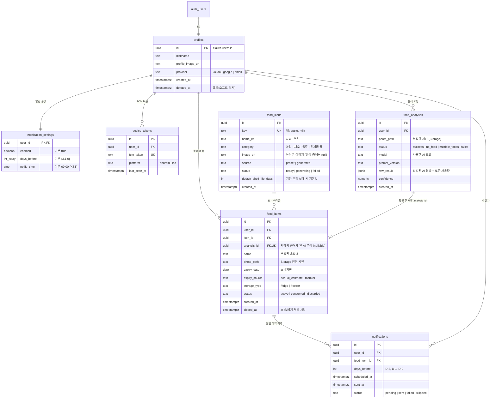

# "먹어도 돼?" 프로젝트 CLAUDE.md

이 폴더(`period_push`)는 "먹어도 돼?" 앱 프로젝트의 루트다. 관리자 사이트는 앱을 만든 뒤에 별도로 정한다.

## 서비스 개요

회원이 찍은 음식 사진을 분석해 소비기한을 관리해 주는 서비스.

1. 회원이 찍은 사진의 음식과 소비기한을 자동으로 분석하고 리스트업한다.
2. 리스트업된 음식은 달력으로 표시된다.
3. 소비기한이 다가온 음식은 푸시 알림으로 알려준다.

## 폴더 구조

| 폴더   | 설명                            | 상세 문서                      |
| ------ | ------------------------------- | ------------------------------ |
| `app/` | 회원용 모바일 앱 ("먹어도 돼?") | `app/CLAUDE.md` (생성 후 작성) |

> `app/`은 Expo 기본 템플릿(`create-expo-app`, `src/app/` 라우팅)으로 초기화되어 있다. `app/AGENTS.md`의 Expo 작업 규칙을 따른다.

## 기술 스택

| 항목          | 기술                                           |
| ------------- | ---------------------------------------------- |
| Framework     | Expo (React Native), Expo Router               |
| Language      | TypeScript                                     |
| Database      | Supabase (PostgreSQL)                          |
| DB 클라이언트 | `@supabase/supabase-js`                        |
| 인증          | Supabase Auth (이메일/비밀번호)                |
| 푸시 알림     | FCM — Android/iOS 공용                         |

## 핵심 도메인

### 인증

- 회원은 **이메일/비밀번호**로 가입하고 로그인한다. (카카오, 구글 소셜 로그인은 제거했다. 필요해지면 다시 추가한다.)
- 구조: `AuthProvider`(`app/src/contexts/auth-context.tsx`)가 세션을 관리하고, 루트 `_layout.tsx`의 `Stack.Protected`가 로그인 여부에 따라 `login` ↔ `(tabs)`를 자동 전환한다. 로그인/가입 화면은 `app/src/app/login.tsx`, 에러 메시지 한글화는 `app/src/lib/auth-errors.ts`.
- Supabase 대시보드의 Providers → Email에서 가입 시 이메일 인증을 켤지 정한다. 켜면 가입 직후 세션이 없고 인증 메일의 링크를 눌러야 한다. 메일 링크는 Site URL로 이동하므로 개발 중에는 꺼 두는 편이 편하다.
- 비밀번호 찾기: 링크 방식이 아니라 **메일로 받은 숫자 코드를 앱에 입력하는 방식**이다 (`app/src/app/forgot-password.tsx`). `resetPasswordForEmail` → `verifyOtp({ type: 'recovery' })` → `updateUser({ password })` 순서이며, 변경이 끝나기 전에는 `isResettingPassword`로 탭 화면 전환을 막는다. 대시보드의 Authentication → Emails → Reset password 템플릿에 `{{ .Token }}`이 들어 있어야 코드가 메일에 표시된다.
- DB의 `profiles.provider`는 마이그레이션상 `kakao | google | email`을 허용하는 상태로 남아 있다 (지금은 항상 `email`).

### 주요 기능과 데이터

1. 회원이 음식 사진을 찍어 Storage에 업로드하고 `food_items` 행을 만든다.
2. 사진 속 음식은 귀여운 아이콘(`food_icons`)으로 변환되어 저장된다. 아직 없는 음식의 아이콘은 AI(Gemini)로 생성해 카탈로그에 쌓는다.
3. 사진에서 소비기한을 파악해 `food_items.expiry_date`에 저장한다.
4. 소비기한 전에 푸시 알림을 보낸다 (아래 알림 규칙 참고).
5. "나의 냉장고" 탭은 냉장고 이미지 위에 아이콘들을 보여준다. 위치는 DB에 저장하지 않고 앱이 목록을 소비기한 임박순으로 정렬해 자동 배치한다.

### 앱 이름과 탭 구조

앱 이름은 **먹어도 돼?** (영문 이름: Can I eat this?, 프로젝트 slug와 딥링크 scheme은 영문 `can-i-eat-this`, `caneatthis`를 유지한다). 하단 탭은 4개이며 라우트는 `app/src/app/`에 있다.

| 탭          | 라우트         | 내용                                  |
| ----------- | -------------- | ------------------------------------- |
| 홈          | `index.tsx`    | 소비기한 음식을 달력으로 표시         |
| 나의 냉장고 | `fridge.tsx`   | 냉장고 이미지 안에 아이콘 음식 배치   |
| 촬영        | `camera.tsx`   | 사진 촬영 → 분석 → 음식 등록          |
| 설정        | `settings.tsx` | 알림 시점, 계정 관리                  |

### ERD

### 설계 메모

- `notifications`에 `(food_item_id, days_before)` UNIQUE 제약을 둬서 같은 알림이 중복 발송되지 않게 한다.
- 음식을 `consumed`/`discarded`로 처리하면 아직 `pending`인 알림은 `skipped`로 바꾼다. 소비기한을 수정하면 `pending` 알림을 다시 계산한다.
- RLS: `profiles`, `notification_settings`, `device_tokens`, `food_items`, `food_analyses`, `notifications`는 `user_id = auth.uid()`인 행만 접근한다. `food_icons`는 전체 읽기만 허용하고, 쓰기는 앱에서 하지 않는다 (서버 함수와 마이그레이션만).
- 마이그레이션은 `app/supabase/migrations/`에 있다 (스키마 → 함수/트리거 → RLS/Storage 순). 가입 시 `profiles`/`notification_settings`는 트리거가 만들고, `food_items` 등록/수정과 알림 설정 변경 시 `notifications`는 트리거가 자동으로 다시 예약한다. 앱에서 `notifications`, `food_analyses`, `food_icons`에 직접 쓰지 않는다.
- 사진은 비공개 Storage 버킷 `food-photos`에 `{user_id}/{파일명}` 경로로 올린다.
- 관리자(admins) 테이블과 관리자 사이트는 앱 완성 후에 설계한다.

### 사진 분석 흐름 (촬영 탭)

1. 카메라로 음식을 찍는다 → 긴 변 약 1024px로 줄여 Storage(`food-photos/{user_id}/…`)에 업로드한다.
2. Edge Function이 Gemini로 사진을 분석하고 `food_analyses`에 한 행을 기록한다. 결과는 음식 이름, 아이콘 key, 소비기한, `expiry_source`(포장지 날짜면 `ocr`, 추정이면 `ai_estimate`), 음식 개수 판정이다. 날짜가 애매하면 null로 두고 사용자가 입력한다.
3. 앱은 결과를 **수정 가능한 입력창**에 채워 보여준다. 사용자가 확인하면 `food_items`가 생성되고 (`analysis_id` 연결), 알림은 트리거가 예약한다.
4. 음식 개수 판정: **같은 종류는 1개, 다른 종류가 섞이면 여러 개**로 본다. 여러 개이면 `status = multiple_foods`로 기록하고 경고창과 함께 재촬영을 요청한다. 음식이 아니면 `no_food`. 분석이 연속으로 실패하면 **"직접 입력하기"** 버튼을 보여준다.
5. 분석 요청은 `food_analyses`에 남으므로 사용자별 하루 호출 한도를 여기서 센다 (재촬영 포함).
6. API 키는 앱에 넣지 않고 Edge Function에서만 사용한다.

구현 위치:
- 앱: `app/src/lib/food-analysis.ts` (리사이즈 → 업로드 → 함수 호출), `app/src/app/camera.tsx` (화면)
- 서버: `app/supabase/functions/analyze-food/index.ts`, 프롬프트와 응답 검증은 `app/supabase/functions/_shared/analysis.ts`
- Gemini `generateContent` REST를 쓰고, 모델은 시크릿 `GEMINI_MODEL`(기본 `gemini-3.5-flash-lite`)로 바꾼다. 시크릿: `GEMINI_API_KEY`, `GEMINI_MODEL`, `ANALYSIS_DAILY_LIMIT`(기본 30).
- 분석 결과(성공/음식 없음/여러 개/실패)는 항상 HTTP 200 + `status`로 돌려주고, 인증 오류·잘못된 요청·한도 초과(429)만 에러 코드로 응답한다.
- 소비기한을 못 구하면 카탈로그 아이콘의 `default_shelf_life_days`로 추정한다. 카탈로그에 없는 아이콘 key는 그대로 돌려주고, 아이콘 생성은 별도 단계에서 처리한다.

### 아이콘 생성 (혼합 방식)

- 흔한 음식 약 30개는 같은 스타일로 미리 만들어 `food_icons`에 넣는다 (`source = preset`).
- 카탈로그에 없는 음식은 AI가 표준 이름(key)을 반환하고, 서버 함수가 `food_icons`에 `generating` 행을 만든 뒤 Gemini로 이미지를 생성해 공개 버킷 `food-icons`에 저장한다 (`source = generated`, `status = ready`). 같은 key가 있으면 재사용하고, 동시 생성은 `key` unique로 막는다.
- 생성되는 동안 앱은 카테고리별 기본 아이콘을 보여주고, 완료되면 교체한다.

### 푸시 알림 규칙 (추천)

- **소비기한 3일 전(D-3), 1일 전(D-1), 당일(D-0)** 에 오전 9시 알림 (`notification_settings`에서 회원이 변경 가능).
- 매일 반복하는 방식은 피곤해서 알림을 끄게 만들기 쉽다. 단계별 카운트다운이 더 효과적이다.
- 등록 시점에 이미 지난 알림은 만들지 않는다. 예를 들어 소비기한이 2일 남은 음식은 D-1, D-0만 예약한다.
- 소비기한이 이미 지난 음식은 하루 한 번만 "확인해 주세요" 알림을 보내고 이후에는 보내지 않는다 (TODO: 필요 여부 결정).

### 푸시 알림 흐름

회원 앱이 로그인 후 FCM 토큰을 `device_tokens`에 저장 → 음식 등록/수정 시 `notifications`에 알림을 예약 → 서버 쪽 스케줄러(DB cron 또는 Edge Function)가 `scheduled_at`이 된 `pending` 알림을 FCM으로 발송하고 `sent_at`/`status` 갱신 → 앱은 알림의 `data.food_item_id`로 해당 음식 상세 화면에 딥링크.

## 코딩 컨벤션

- 주석은 한글로 작성한다.
- 커밋 메시지는 한글로 작성한다.
- DB 컬럼명은 snake_case, TS 변수/함수는 camelCase.
- Supabase 타입은 `supabase gen types typescript --linked`로 생성하며, 직접 손으로 수정하지 않는다.
- 새 테이블은 RLS까지 포함한 마이그레이션(`app/supabase/migrations/`)으로 추가한다.
